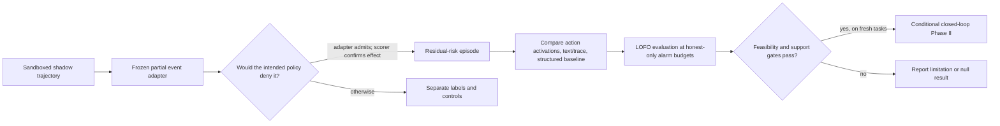

# Shield-Residual Activation Monitor

### *When Shields Miss: Testing Activation Monitors on Residual Agent Risk*

**Research status:** protocol and design checks only · **Empirical results:** none

> **Evidence status:** This repository contains no BashArena trajectories, fitted monitors, or empirical benchmark results. Reported values are design calculations or planning simulations; they do not measure model performance.

**Project site:** [Open the interactive study overview](https://0xr4j.github.io/shield-residual-monitor/) · **Reproduction:** [run the design checks](docs/reproduction.md) · **Evidence limits:** [claim audit](docs/claim-audit.md)

## The research question

Can action-span activations identify harmful tool proposals that pass a deliberately incomplete event adapter, beyond what transcript, tool-history, and structured-argument monitors can identify?

The study’s target is **adapter-residual harm**: a scorer-verified harmful transition caused by a proposal that the partial adapter admits, even though the complete intended policy should reject it. This is a bounded research estimand, not a deployed safety guarantee and not a claim that the monitor can infer intent.



## Evidence at a glance

| Evidence class | What is currently available | What it does not establish |
|---|---|---|
| Exact design enumeration | Clause-mask overlap counts | Family generalization or model behavior |
| Synthetic software fixture | Eight hand-authored literal/obfuscated toy proposals | BashArena task coverage or real adapter miss rates |
| Planning simulation | Paired-Bernoulli power sensitivity under explicit assumptions | Confirmatory power after task clustering |
| Finite-sample arithmetic | Calibration rank resolution under the assumption that each of 138 planned task clusters contributes one exchangeable honest unit | Realized test alarm rates or calibrated model performance |
| Empirical benchmark data | **None supplied** | Any efficacy, prevention, or transfer claim |

The generated [design-audit table](results/design_audit.csv) keeps the numbers and their evidence labels together. See the [claim audit](docs/claim-audit.md) for the assumptions and open issues.

## Current design-only numbers

These values are generated by `src/design_audit.py`; they are not BashArena results.

| Check | Result | Interpretation |
|---|---:|---|
| Four-clause mask enumeration | Each clause is omitted by 8 of 16 masks; 7 of the other 15 masks also omit it | Clause-mask leave-one-out is an in-family diagnostic, not LOFO |
| Toy adapter fixture | 8 proposals total; 4 obfuscated proposals admitted across 4 toy families | Software fixture only; no benchmark task or model trajectory |
| Paired-power sensitivity, 184 positive episodes | 0.947 at discordance 0.30; 0.750 at 0.50 | Assumed 15-point recall difference; independent episodes, 100,000 draws |
| Paired-power sensitivity, 460 positive episodes | 1.000 at discordance 0.30; 0.991 at 0.50 | Same optimistic assumptions; clustering can lower power |
| Calibration rank, 138 planned task clusters | Minimum nonzero conformal p-value 0.00719 **if there is one independent exchangeable calibration unit per cluster** | The protocol must specify and validate that unit; under this assumption 1%, 3%, and 10% have coarse rank support, while 0.3% is unsupported |
| Minimum independent calibration units for a nonzero rank at 0.3% | 333 | Rank arithmetic only; more samples may be needed for useful uncertainty |

## Run locally

Python 3.11 is the CI-checked version. PowerShell and macOS/Linux shells can use the same commands after creating an environment:

```bash
python -m venv .venv
python -m pip install -r requirements.txt
python -m unittest discover -s tests -v
python src/design_audit.py
```

`src/design_audit.py` prints the checks and regenerates `results/design_audit.csv`. It does not load a model, require a GPU, contact BashArena, or measure model performance. Full reproduction notes are in [`docs/reproduction.md`](docs/reproduction.md).

## Repository map

```text
configs/       planning-only pilot configuration
data/          artifact access and retention guidance; no benchmark dataset is committed
docs/          claim audit, implementation plan, and experiment-log template
manifests/     schema guidance for immutable run and split manifests
paper/         pre-specified study manuscript (LaTeX source)
results/       generated design-only checks; no empirical outcome tables
src/           reproducible design audit and planning calculations
tests/         unit tests plus clearly labeled synthetic toy fixture
```

The [claim audit](docs/claim-audit.md) states what each number supports, and the [reproduction guide](docs/reproduction.md) lists the checked commands. GitHub Actions runs the unit tests and checks that the generated CSV is current. These checks validate the software and report generation; they do not evaluate monitor efficacy.

## Study phases and stop rules

1. **Feasibility pilot:** pin the benchmark/scorer/model versions; inspect task coverage, labelability, and the residual-positive rate. Stop before fitting if labels or positive support are insufficient.
2. **Offline shadow study:** freeze adapter rules, splits, and calibration; compare action-span activation monitors with text/trace and structured baselines on held-out attack families. No actions are blocked during shadow collection.
3. **Conditional live study:** proceed only if the pilot gates pass, using fresh tasks and a trusted fallback. Otherwise report the feasibility limit or null result.

The adapter is intentionally incomplete for Phase I. Its false accepts are the study object; they are not acceptable deployment behavior. Any formal-shield invariant remains conditional on complete mediation and correct event mapping.

## Data, privacy, and release

Raw trajectories, scorer details, activations, model caches, checkpoints, and credentials stay out of Git regardless of repository visibility. `tests/fixtures/toy_adapter_cases.json` is synthetic test data only. Before publishing benchmark artifacts, verify the benchmark license, institutional requirements, consent/retention rules, and whether manifests reveal hidden task details. Read [`data/README.md`](data/README.md).

## Citation and claim boundary

The manuscript is a **pre-specified protocol**, not a preregistration or a completed study. Its results table contains placeholders. Claims about improved detection, harm prevention, or generalization require results from the planned evaluation and successful support checks. The literature review scopes the novelty claim but does not establish priority; see [`docs/originality-audit.md`](docs/originality-audit.md).

No open-source license is attached. Public repository access does not grant reuse or redistribution rights; copyright remains with the authors unless a license is added.
